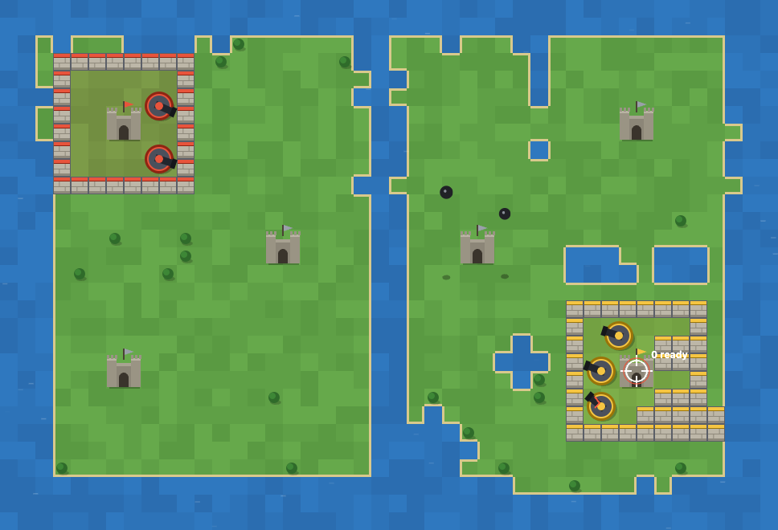

# Rampart (browser)

A browser game inspired by the 1990 arcade classic *Rampart*. Build walls, place cannons and pound your rival's castle until it falls. Play against the computer or a friend sharing the same mouse.

**[▶ Play it now](https://buildandpromote.github.io/rampart-web/)**

## How to play

Each round has three phases, and the players take turns in each one.

1. **Place cannons.** Click inside your walls to drop them. Bigger territory and more castles earn more cannons.
2. **Battle.** Click to fire your nearest ready cannon at the crosshair. Knock holes in enemy walls and destroy their cannons.
3. **Rebuild.** Drop Tetris-style wall pieces to seal your castle again. A castle left open at the end of your rebuild is destroyed. Seal in an empty castle to claim it.

At the start you claim one castle, and a ring of walls appears around it. Lose every castle and you lose. After 8 rounds, the player with the most castles wins (score breaks a tie).

## Controls

| Action | Input |
|---|---|
| Place cannon / fire / place wall | Left click |
| Rotate wall piece | Right-click, R, Space or mouse wheel |
| Finish your turn early | Enter or the **Done** button |

Tick **Trackball feel** to make the crosshair trail the mouse a little, closer to the arcade trackball. The computer comes in Easy, Normal and Hard.

## Run it locally

No install or build step. Download `index.html` and open it in any modern browser.

## Project layout

| Path | What it is |
|---|---|
| `index.html` | The whole game: canvas and plain JavaScript, no dependencies |
| `docs/rules.md` | Rules and tuning numbers, kept in step with the code |
| `docs/backlog.md` | Known gaps and planned work |
| `docs/playtest-log.md` | Test findings, newest first |
| `tools/playthrough.js` | Automated full-game test, run in the browser console |
| `CLAUDE.md` | Working notes for Claude Code |

## Credits

An unofficial fan project, not affiliated with Atari Games or the owners of *Rampart*. All art and sound are original and drawn or synthesised in code.
